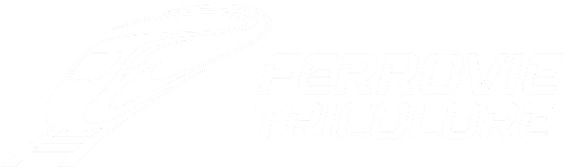
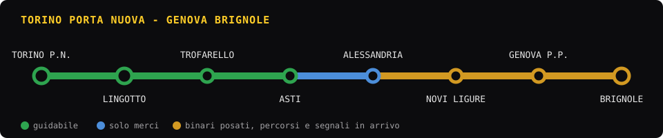
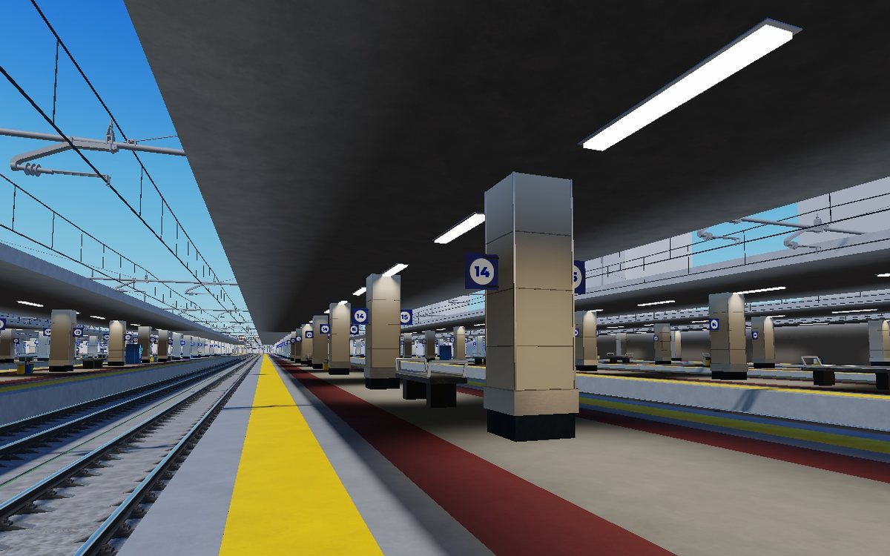
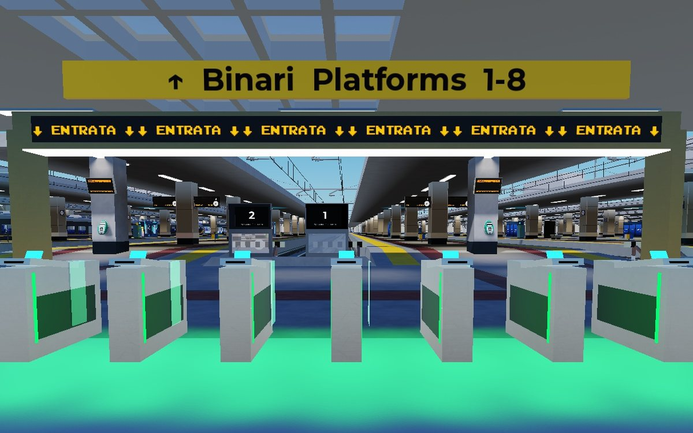
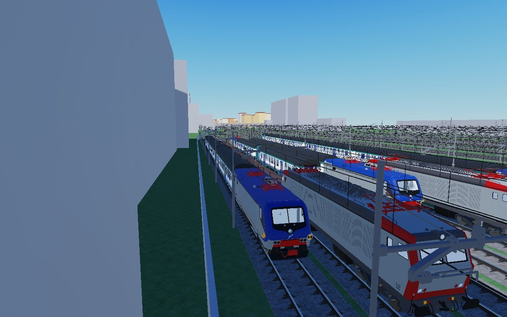
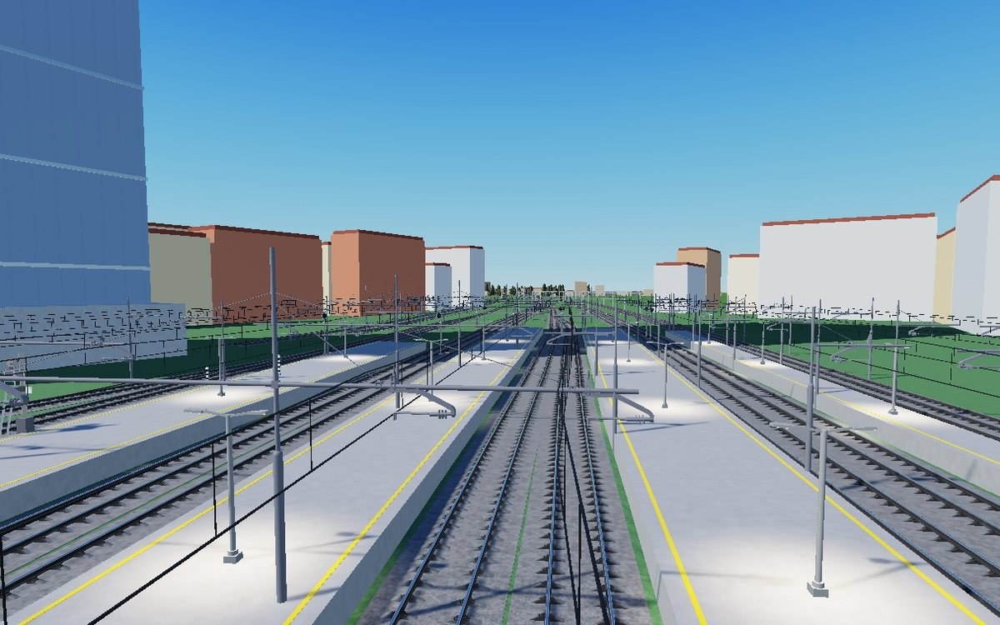

  

  

 

Un simulatore ferroviario su Roblox costruito su una regola sola: **i binari devono essere quelli veri**. Le stazioni vengono dalle mappe ferroviarie, i segnali funzionano a blocchi come sulla linea vera e sulla linea non sei mai solo: girano anche i treni guidati dal gioco.

Si parte da Torino Porta Nuova. Oggi si guida fino ad Asti, i merci arrivano ad Alessandria e la linea per Genova è già posata.

> [!NOTE]
> Il gioco è in sviluppo e non è ancora pubblico. Adesso è in corso un playtest chiuso; gli aggiornamenti escono prima sul [Discord](https://discord.gg/pH62fm3nkG).

## 🚉 Partenze

| Treno | Destinazione | Stato |
|:--|:--|:--|
| `REG` `RV` | **Torino Lingotto** | 🟢 guidabile, con traffico IA |
| `REG` `RV` | **Asti** via Moncalieri, Trofarello, Villanova d'Asti | 🟢 guidabile, si parte anche da Lingotto e da Asti |
| `MERCI` | **Alessandria** dal deposito di Porta Nuova | 🟢 guidabile |
| `REG` | **Genova Brignole** via Alessandria, Novi Ligure | 🟡 binari posati, percorsi e segnali in arrivo |
| `RV` | **Ventimiglia** via Savona | ⚪ in programma |
| `IC` | **Milano Centrale** via Novara | ⚪ in programma |

  

## 🎛️ Una corsa

Componi il treno veicolo per veicolo, alzi il pantografo, carichi i freni e chiedi la partenza. Il tabellone mostra il tuo treno appena ti siedi in cabina, l'annuncio parte quando chiedi il via e il semaforo decide quando puoi muoverti.

In banchina apri le porte dal lato giusto e lasci salire i passeggeri. All'arrivo la stazione ti annuncia sul binario. Chi viaggia da passeggero compra il biglietto, lo timbra e passa i tornelli.

  
  
  
  

## 🚃 Parco rotabili

Ogni mezzo arriva con le livree che ha avuto davvero in servizio.

| Rotabile | Livree | |
|:--|:--|:--:|
| **E464** | XMPR · Regionale · Intercity · Intercity Giorno · Frecciabianca · Trenord | 🟢 |
| **Mazinga** (semipilota) | Origine · XMPR · DTR | 🟢 |
| **MDVC** | Origine · XMPR · DTR | 🟢 |
| **POP** | DPR · Regionale · Trenord · Trenitalia Tper | 🟢 |
| **E652** | Origine · Blu orientale e grigio perla · XMPR · Mercitalia Rail | 🟢 |
| **CDPTR** (+ pilota) | DPR · XMPR | 🟢 |
| **Carri merci** | DDm · Rgmms | 🟢 |
| **MDCE** | XMPR · DTR | 🟡 |
| **Rock** | DPR · Regionale · Trenord · Trenitalia Tper | ⚪ |
| **TAF** | XMPR · DTR · Trenord · FNM · LeNord · Malpensa Express | ⚪ |
| **E405** | XMPR | ⚪ |
| **Taurus** (E190) | ÖBB Italia · FUC Ferrovie Udine Cividale | ⚪ |
| **Frecciargento** | Frecciargento · Frecciarossa | ⚪ |
| **Italo** | Italo | ⚪ |

🟢 nel gioco &nbsp; 🟡 in lavorazione &nbsp; ⚪ da fare

## 🗺️ Stato dei lavori

- [x] Torino Porta Nuova: 20 binari, gola, due depositi, Sala Comandi
- [x] Stazione completa: tabelloni, tornelli, biglietterie, timbratrici, arredi
- [x] Collegamento reale Porta Nuova - Lingotto, con linea aerea
- [x] Linea Lingotto - Asti con le stazioni intermedie
- [x] Traffico IA che rispetta semafori e limiti
- [x] Composizione dei treni e carri merci
- [x] Monete e negozio
- [ ] Linea aerea Lingotto - Asti
- [ ] Linea per Genova guidabile fino in fondo
- [ ] Livree per tutti i rotabili
- [ ] Genova - Ventimiglia e Torino - Milano

## ⚙️ Come è fatto

Per chi è curioso del lato tecnico

 

- **Movimento.** Il treno non usa la fisica delle ruote: segue i punti del tracciato, e ogni cassa è costruita dai suoi due carrelli, così in curva si comporta come quella vera.
- **Scala.** I binari sono tile da 20 studs posati sui dati di OpenStreetMap, a 3,011 studs per metro, ricavati dalla distanza reale fra Porta Nuova e il ponte di corso Bramante.
- **Percorsi.** Vengono generati dai binari stessi; verso Asti un grafo dei binari sceglie il percorso e il binario d'arrivo libero.
- **Segnalamento.** Blocco automatico a tre aspetti con due sezioni di preavviso; in stazione la partenza va autorizzata.
- **Treni IA.** Guidati dal server, occupano e liberano i blocchi come un treno vero. Se un treno IA fermo occupa il binario scelto da un giocatore, gli lascia il posto.
- **Linea aerea.** Il palo giusto (singolo o a ombrello fino a sei binari) viene scelto in base a dove cadono i suoi ganci rispetto ai binari.
- **Orari.** Tutto segue l'ora italiana, ora legale compresa.

🇬🇧 English

 

A railway simulator on Roblox built around one rule: the tracks have to be the real ones. Stations come from railway map data, signals work in blocks like on the real line, and server-driven AI trains share the line with players.

It starts at Torino Porta Nuova. Today you can drive to Asti, freight trains reach Alessandria, and the line to Genova is already laid. The game is in development and not public yet; a closed playtest is running and updates go out first on Discord.

| Train | Destination | Status |
|:--|:--|:--|
| `REG` `RV` | Torino Lingotto, Asti | drivable, with AI traffic |
| `MERCI` | Alessandria | drivable |
| `REG` | Genova Brignole | tracks laid |
| `RV` `IC` | Ventimiglia, Milano Centrale | planned |

 

© 2026 Tommy Raffaello Hodoroaba (73K-Y) · TOMHODA Studios · Tutti i diritti riservati, vedi <a href="LICENSE">LICENSE</a>

